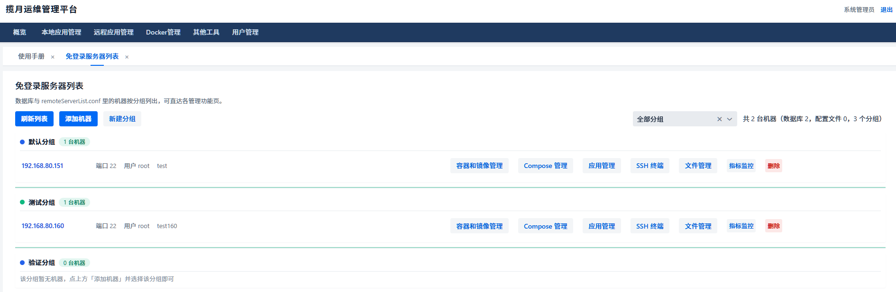
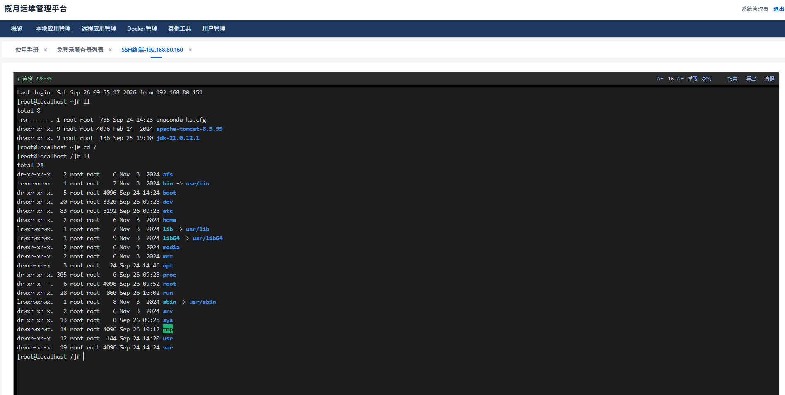
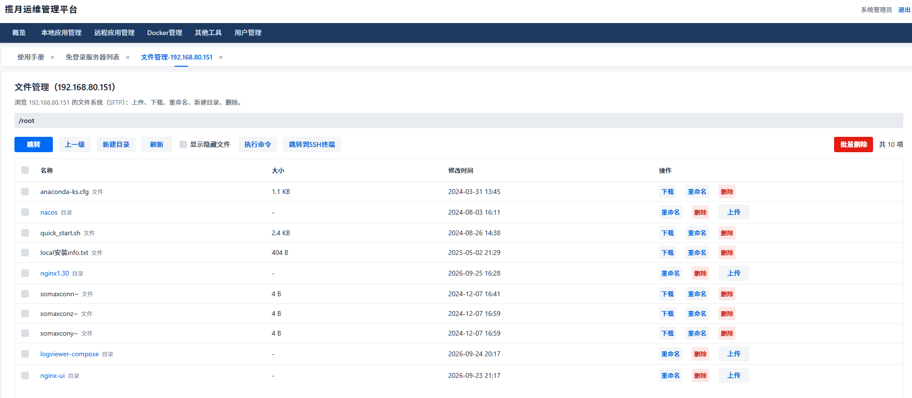
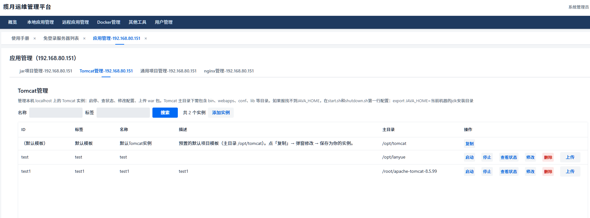
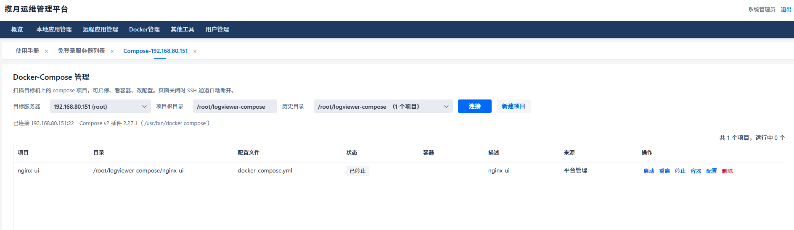
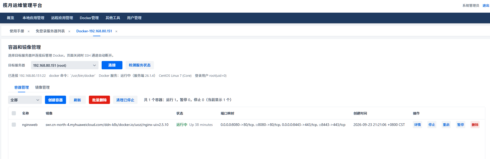
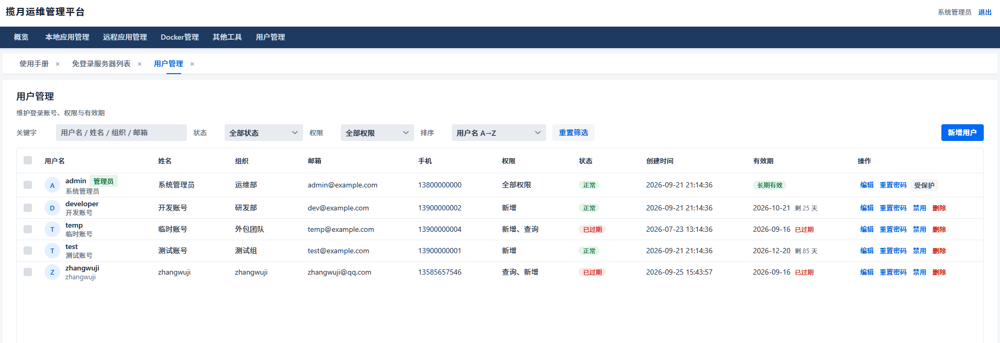

# Lanyue Ops Management Platform

English | [中文](README.md)

A self-service ops platform for small and mid-sized teams: manage servers, search logs, browse files, deploy applications, operate Docker / Docker-Compose, and work in SSH terminals — all from the web, no more hopping between machines in a shell.

Built on **Spring Boot 3.5 + Vaadin 24**, shipped as a single jar, and compatible with both **SQLite** (works out of the box) and **MySQL 8**.



---

## Table of Contents

- [Features](#features)
- [Architecture](#architecture)
- [Quick Start](#quick-start)
- [Configuration](#configuration)
- [Default Accounts](#default-accounts)
- [Project Layout](#project-layout)
- [FAQ](#faq)

---

## Features

### Overview

- **User Manual**: built-in usage guide, opened by default after login.

### Local Application Management

- **Local Log Search**: search local log files by keyword and time range, with highlighted detail view.
- **Local File Management**: browse and edit local files. Plain-text files (whitelisted extensions) are edited in the browser via a CodeMirror editor with automatic highlighting per file type (yaml / nginx / shell / properties, etc.).
- **JAR Project Management**: register local jar applications, start / stop / restart with one click, track running status.
- **Tomcat Management**: deploy and manage Tomcat instances.
- **Generic Project Management**: register any application by "host + project", with custom start/stop commands and status-check keywords (e.g. nginx).

### Remote Application Management

**Password-free Server List** — centrally manage all remote hosts (SSH password / key), organized in groups. Each machine offers six inline entries:

| Entry | Description |
| --- | --- |
| Containers & Images | View, start, stop, delete remote Docker containers / images |
| Compose | Start / stop, edit configs, and create docker-compose projects |
| App Management | Run preset start / stop / restart / status-check commands |
| SSH Terminal | Native in-browser terminal (xterm.js + WebSocket), font size and theme switching |
| File Management | SFTP browsing: upload, download, rename, delete, inline editing, cross-host file distribution |
| Metrics | CPU / memory / disk sampling and top-10 processes, auto-refreshed every 5 s |

**Remote Log Search** — grep log files on remote machines over SSH, view matches online.

### Docker Management

- **Containers & Images**: container lifecycle operations, log viewing, terminal access; image listing and cleanup.
- **Docker-Compose**: manage registered compose projects on remote hosts — create projects (multi-file YAML editor), start / restart / stop, config diff, directory history switching.

### drawio Diagrams

Embedded draw.io editor + per-user diagram library: switch diagrams from a dropdown, save from inside the editor straight to the database, save-as and delete supported.

### Linux Tools

- **Common Linux Operations**: day-to-day SSH chores turned into buttons — firewall on/off and port rules, users and sudo grants, service start/stop, system inspection (memory / disk / processes / ports / SELinux status), crontab editing, hostname changes. High-risk operations are deliberately excluded.
- **Linux Command Reference**: an offline command handbook with 152 built-in commands (category / summary / parameters / copyable examples / remarks), imported automatically on first deployment — no manual initialization needed.
- **Script Management**: card-style shell script library for saving, searching, copying, and running scripts.
- **Custom Script Monitoring**: pick a server and a monitoring script (editable inline), run it on a configured interval, and see the parsed metrics in a table (last 10 rounds kept).

### Other Tools

| Tool | Description |
| --- | --- |
| JSON Beautifier | Auto-beautifies on paste, CodeMirror editor |
| Base64 Codec | Text encode/decode, image to Base64 (optional Data URI prefix) |
| Encryption | Common digests and symmetric ciphers, incl. SM3 / SM4 (BouncyCastle) |
| QR Code Generator | Adjustable format / error-correction level / size, downloadable |
| Regex Tester | Common expression templates, match highlighting, capture groups, batch replace (with `$1` references), cheat sheet |
| Cron Generator | Tabs for three mainstream formats (Linux crontab / Quartz / Spring), field-by-field visual configuration |
| Image Compressor | Multi-select / drag-and-drop, output format and quality options, per-file savings |
| Image Converter | HEIC / JPG / PNG / WebP / GIF / BMP / TIFF / AVIF / ICO conversion, done entirely in the browser |
| Text Diff | Two-pane diff with red / green line highlighting in place |

### GitHub Favorites

Card-style open-source project collection: name, description, one-click jump to GitHub, with categories and editing.

### Users & Permissions

- Spring Security based login; passwords stored as BCrypt (legacy SM3 digests are upgraded transparently at login). Accounts freeze for 10 minutes after 5 consecutive failed attempts.
- **RBAC Role Management**: roles are sets of permissions; the permission tree has two levels — root = menu, child = in-page action buttons. Granting the root opens the door; granting children unlocks buttons.
- User management supports account CRUD, expiry (auto-disabled when reached), and role assignment.

### Screenshots

**SSH Terminal** (xterm.js, operate remote machines in the browser):



**File Management** (SFTP upload/download, rename, batch delete, jump to terminal):



**App Management** (preset commands, one-click execution):



**Docker-Compose Management**:



**Image Management**:



**User Management**:



---

## Architecture

```
┌────────────────────────────────────────────────────────────┐
│                        Browser                             │
│        Vaadin 24 server-side UI + xterm.js terminal        │
└──────────────┬──────────────────────────┬──────────────────┘
               │ HTTP (session auth)      │ WebSocket
┌──────────────▼──────────────────────────▼──────────────────┐
│                Spring Boot 3.5 (embedded Tomcat, 9095)     │
│                                                            │
│  ┌────────┐ ┌─────────┐ ┌──────────┐ ┌─────────────────┐   │
│  │ UI     │ │ Security│ │ Services │ │ WebSocket ports │   │
│  │ Vaadin │ │ Spring  │ │ Docker / │ │ /ws/ssh         │   │
│  │ Views  │ │ Security│ │ Compose/ │ │ /ws/docker      │   │
│  │ Menu   │ │ SM3+BCr │ │ logs/files│ │ terminal tokens │   │
│  └────────┘ └─────────┘ └──────────┘ └─────────────────┘   │
│         │              │            │                      │
│  ┌──────▼──────────────▼────────────▼───────────────────┐  │
│  │  MyBatis-Plus (pagination dialect auto-detected)     │  │
│  │  HikariCP connection pool                            │  │
│  └──────┬───────────────────────────────────────────────┘  │
└─────────┼──────────────────────────────────────────────────┘
          │
   ┌──────▼──────┐    ┌─────────────────────────────────┐
   │ SQLite /    │    │ Remote hosts (SSH pool reused)  │
   │ MySQL 8     │    │  sshj: SFTP / exec / pty        │
   │ dual-dialect│    │  docker / docker-compose CLI    │
   └─────────────┘    └─────────────────────────────────┘
```

Key design points:

- **Zero separate frontend deployment**: Vaadin server-side rendering; frontend TypeScript (CodeMirror 6 wrapper) is built by Vite into the jar.
- **SSH connection pool**: all remote operations reuse pooled connections; SSH is uniformly handled by sshj (SFTP, exec, pty terminal).
- **WebSocket terminals**: SSH interaction goes through `/ws/ssh` with session authentication in the handshake plus a one-time terminal token check.
- **Dual database support**: SQL dialect differences are contained in `com.sl.db.DatabaseDialect`; business code never branches on the database product. The pagination plugin detects the dialect from the JDBC URL.
- **Bootstrap on startup**: `DbInitializer` idempotently creates tables / adds missing columns, guarantees the built-in admin can log in, seeds the RBAC permission tree, and imports the Linux command seed data (152 rows) whenever `linux_cmd` is empty — a fresh environment starts without running any script.
- **Log4j2 only**: default logback of every Spring Boot starter is explicitly excluded; see `log4j2.xml`.

Tech stack:

| Layer | Components |
| --- | --- |
| UI | Vaadin 24.10, CodeMirror 6, xterm.js, ECharts |
| Backend | Spring Boot 3.5.0, Spring Security, Java 21 |
| Data | MyBatis-Plus 3.5.12, HikariCP, SQLite / MySQL 8 |
| Remote ops | sshj 0.40, docker CLI |
| Utilities | Hutool, FastJSON2, Apache POI (Excel export), BouncyCastle (SM ciphers), zxing (QR codes) |

---

## Quick Start

### Requirements

- JDK 21+
- Maven 3.9+ (Node environment is provisioned by the Vaadin plugin)
- Target machines to manage remotely: SSH open (port 22); docker / docker-compose installed (optional)

### Run in development mode

```bash
mvn spring-boot:run
```

Then open `http://localhost:9095/log`. The `dev` profile (SQLite) is active by default; on first startup the database, tables, and built-in data (Linux command handbook) are created automatically — no manual initialization.

> The first build downloads frontend dependencies and takes a while; that is normal.

### Production build

```bash
mvn clean package -Pproduction -DskipTests
java -jar target/lanyue-1.0-SNAPSHOT.jar
```

`-Pproduction` runs `build-frontend` during compile so the frontend assets are compiled into the jar.

### Switching to MySQL 8

```bash
java -jar lanyue.jar --spring.profiles.active=mysql
```

A complete checklist for creating the database, tables, and migrating data lives in the comments of [`src/main/resources/application-mysql.properties`](src/main/resources/application-mysql.properties). Table structure and seed data are also bootstrapped at startup, so it starts even without running the scripts.

---

## Configuration

All configuration lives in `src/main/resources/`:

| File | Purpose |
| --- | --- |
| `application.properties` | Main config: port, context path, shared datasource params, MyBatis, upload limits |
| `application-dev.properties` | dev profile: SQLite environment |
| `application-mysql.properties` | mysql profile: MySQL 8 datasource (with full migration notes) |
| `log4j2.xml` | Logging (the only log backend; logback is forbidden) |
| `demo.sql` / `demo-mysql8.sql` | Manual initialization scripts for SQLite / MySQL (with demo data; always edit both in sync) |
| `seed/linux_cmd.sql` | Linux command handbook seed data (generated by `scripts/gen_linux_cmd_sql.py` from `linux_commands.csv`; imported only when the table is empty) |

### Core settings

```properties
# Port and context path (access URL http://host:9095/log)
server.port=9095
server.servlet.context-path=/log

# Profile switch: dev=SQLite, mysql=MySQL 8
spring.profiles.active=dev

# Upload limits (file management)
spring.servlet.multipart.max-file-size=200MB
spring.servlet.multipart.max-request-size=300MB
```

### Inline file-editing whitelist

Which remote files may be edited in the browser is controlled by:

```properties
# Editable extensions (case-insensitive, comma-separated)
pure.text.type=txt,markdown,md,yml,yaml,conf,ini,log,csv,properties,sql,xml,html
# Max size per file, supports B/K/M/G suffixes
pure.text.type.maxsize=10M
```

### SQLite vs MySQL

- **SQLite (dev)**: zero configuration — the `demo.db` file is the database, WAL mode enabled. Good for single machines, small teams, and demos. Pool is fixed at 8 connections (SQLite allows a single writer; a larger pool only adds lock contention).
- **MySQL 8 (mysql)**: for concurrent multi-user use. URL params follow Connector/J best practices (utf8mb4, batch rewriting, timezone). The database charset **must be utf8mb4** — the app checks it at startup and warns.

---

## Default Accounts

| Account | Source | Notes |
| --- | --- | --- |
| `admin` | Startup bootstrap (`DbInitializer`) | System administrator; guaranteed to exist and be able to log in on every startup. Initial password `admin` — **change it immediately** |
| `test` / `developer` / `guest` / `temp` | `demo.sql` (only if imported manually) | Demo accounts covering different permission and expiry scenarios |

Passwords are stored as digests (SM3 / BCrypt); a leaked database does not leak passwords.

---

## Project Layout

```
lanyue/
├── src/main/java/com/sl/
│   ├── Application.java          # Entry point (@Push config lives here)
│   ├── ui/                       # Vaadin UI layer
│   │   ├── MainView.java         # Main frame (menu + tabs)
│   │   ├── MenuRegistry.java     # Static menu definition (groups / permissions)
│   │   ├── component/            # Shared components (UiFactory, CodeEditor, Dialogs…)
│   │   ├── local/                # Local management pages
│   │   ├── remote/               # Remote management pages
│   │   ├── docker/               # Docker / Compose pages
│   │   ├── admin/                # User & role management
│   │   └── tool/                 # drawio, Linux tools, misc utilities
│   ├── docker/                   # Docker / Compose service layer
│   ├── security/                 # Auth (SM3 → BCrypt progressive migration)
│   ├── db/                       # Database dialect abstraction
│   ├── config/                   # DbInitializer, MyBatis, security, etc.
│   ├── controller/               # WebSocket endpoints (SSH / Docker terminals)
│   ├── mapper/  entity/          # MyBatis-Plus data access
│   └── util/                     # Utilities
├── src/main/frontend/            # Frontend TS (CodeMirror 6 wrapper etc.)
├── src/main/resources/           # Config, seed data, logging config
├── scripts/                      # Verification & seed-data generation scripts
├── img/                          # README screenshots
└── pom.xml
```

---

## FAQ

**Q: Nothing responds on port 9095?**
The context path is required: `http://localhost:9095/log`. The root path returns 404 by design.

**Q: After adding a dependency, startup warns about multiple SLF4J providers?**
The new dependency pulled in `spring-boot-starter-logging` (logback). The only log backend here is Log4j2 — add an exclusion for it in `pom.xml`, following the existing exclusions.

**Q: A remote machine won't connect?**
Check the SSH port, credentials / key, and firewall. Connections are configured in the "Server List" page and support both password and key authentication.

**Q: After switching from SQLite to MySQL, is my old data still there?**
No. The two databases are independent. Migration steps (create DB → create tables → move data table by table → switch profile) are listed in `application-mysql.properties`. Password digests are database-agnostic — move them over and login still works.

**Q: The Linux command reference page is empty?**
This should not happen — the seed data (152 rows) is imported automatically when the `linux_cmd` table is empty. If the table was cleared manually, a restart re-imports it. To change the handbook, edit `linux_commands.csv` in the project root, re-run `scripts/gen_linux_cmd_sql.py`, then clear the table and restart.

**Q: nginx reverse proxy config must be changed — WebSocket is not forwarded by default**

```nginx
# In the http{} block (skip if an identical map already exists)
map $http_upgrade $connection_upgrade {
    default upgrade;
    ''      close;
}

# Inside the 443 server block
location /log/ {
    proxy_pass http://127.0.0.1:9095/log;
    proxy_http_version 1.1;
    proxy_set_header Upgrade $http_upgrade;          # ← root fix
    proxy_set_header Connection $connection_upgrade; # ← root fix
    proxy_set_header Host $host;
    proxy_set_header X-Forwarded-Proto https;        # fixes http:// redirects
    proxy_set_header X-Forwarded-Host $host;
    proxy_set_header X-Forwarded-Port 443;
    proxy_set_header X-Forwarded-For $proxy_add_x_forwarded_for;
    proxy_read_timeout 3600s;   # default 60s periodically kills push/terminal connections
    proxy_send_timeout 3600s;
    proxy_buffering off;
}
```

### Using the embedded drawio feature

1. Create a `drawio` directory next to the running jar, copy everything from `webapps/` of the latest drawio source into it (it should contain mxgraph, styles, js, images, math4, shapes, resources, etc.), then restart the application.
